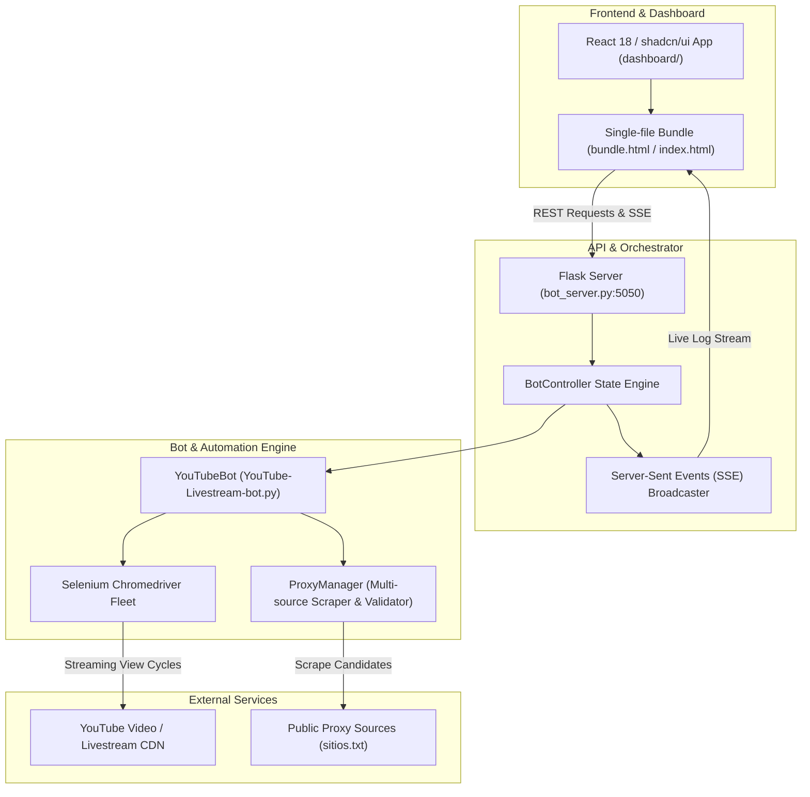

# Architecture Documentation — Phoenix YouTube Livestream Bot

This document outlines the architecture, component relationships, data flow, and interactive graph models for the Phoenix YouTube Livestream & View Bot codebase.

---

## 🧭 Architecture Visualizations

The official architecture visualization model for this repository has been generated using **Archify**:

1. **Interactive Showcase Architecture ([architecture.html](file:///Users/arya/.gemini/antigravity-ide/scratch/Youtube-Livestream-bot/architecture.html))**:
   - Built with **Archify** (`tt-a1i/archify` showcase profile).
   - Fully standalone interactive HTML with dark/light themes, live motion, canvas zoom/pan, component details, boundary isolation, and SVG/WebM export.
   - Live file: [.archify/architecture-youtube-bot-20261025-211500/youtube-bot.html](file:///Users/arya/.gemini/antigravity-ide/scratch/Youtube-Livestream-bot/.archify/architecture-youtube-bot-20261025-211500/youtube-bot.html) (copied to root [architecture.html](file:///Users/arya/.gemini/antigravity-ide/scratch/Youtube-Livestream-bot/architecture.html)).
2. **System Blueprint Artifact ([architecture_diagram.md](file:///Users/arya/.gemini/antigravity-ide/brain/96019bda-f8b4-4edf-b9e3-925772d56b5a/architecture_diagram.md))**:
   - High-level C4 container diagrams, runtime sequence diagrams, and anti-detection evasion matrix.

---

## 🏗️ System Layers



---

## 📂 Core File Map & Responsibilities

| Component | Path | Language / Tech | Primary Function |
| :--- | :--- | :--- | :--- |
| **Server Backend** | [bot_server.py](file:///Users/arya/.gemini/antigravity-ide/scratch/Youtube-Livestream-bot/bot_server.py) | Python 3, Flask | Handles `/api/start`, `/api/stop`, `/api/status`, and SSE log broadcast. |
| **Bot Engine** | [YouTube-Livestream-bot.py](file:///Users/arya/.gemini/antigravity-ide/scratch/Youtube-Livestream-bot/YouTube-Livestream-bot.py) | Python 3, Selenium | Orchestrates multi-window Chrome sessions, handles ad skips, and tracks interaction cycles. |
| **Proxy Manager** | [YouTube-Livestream-bot.py:130](file:///Users/arya/.gemini/antigravity-ide/scratch/Youtube-Livestream-bot/YouTube-Livestream-bot.py#L130) | Python 3, Concurrent Futures | Validates proxies in parallel (50 workers) against YouTube endpoints. |
| **Control Deck UI** | [dashboard/src/App.tsx](file:///Users/arya/.gemini/antigravity-ide/scratch/Youtube-Livestream-bot/dashboard/src/App.tsx) | React 18, TypeScript, Tailwind | Modern cyberpunk dark dashboard with stream parsing, sliders, radar, and terminal. |
| **Bundled Web App** | [web/templates/index.html](file:///Users/arya/.gemini/antigravity-ide/scratch/Youtube-Livestream-bot/web/templates/index.html) | HTML5, CSS3, ES Modules | 374 KB self-contained artifact served directly by Flask at `http://localhost:5050`. |
| **Launcher** | [run_ui.sh](file:///Users/arya/.gemini/antigravity-ide/scratch/Youtube-Livestream-bot/run_ui.sh) | Bash | Auto-cleans stale drivers, frees port `5050`, and launches the Flask server. |

---

## 🚀 Quick Commands

- **Start Web Dashboard**:
  ```bash
  ./run_ui.sh
  ```
- **Open Interactive Architecture Diagram in Browser**:
  ```bash
  open architecture.html
  # or open .archify/architecture-youtube-bot-20261025-211500/youtube-bot.html
  ```
